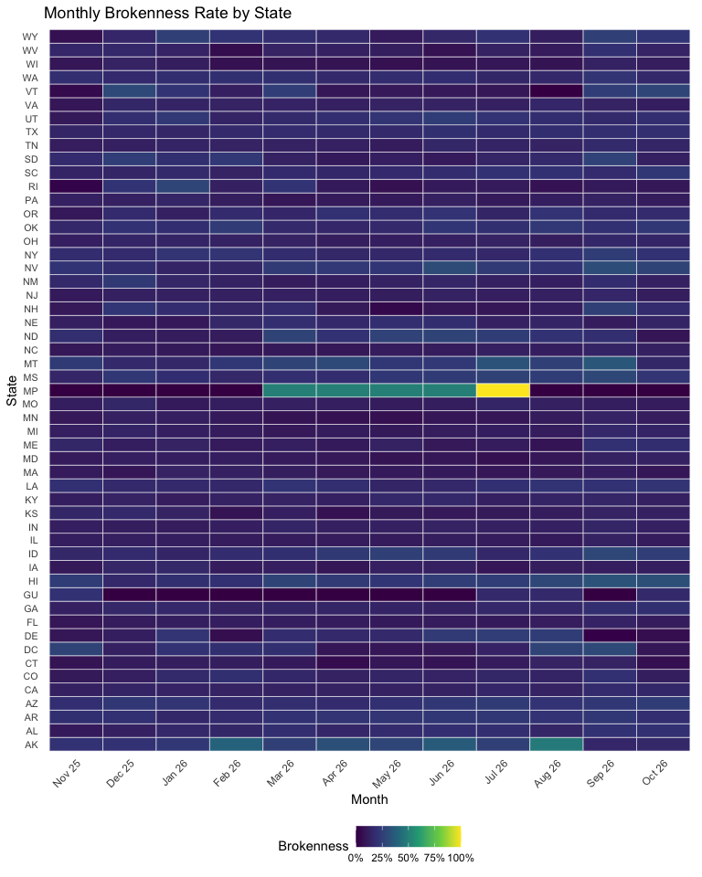
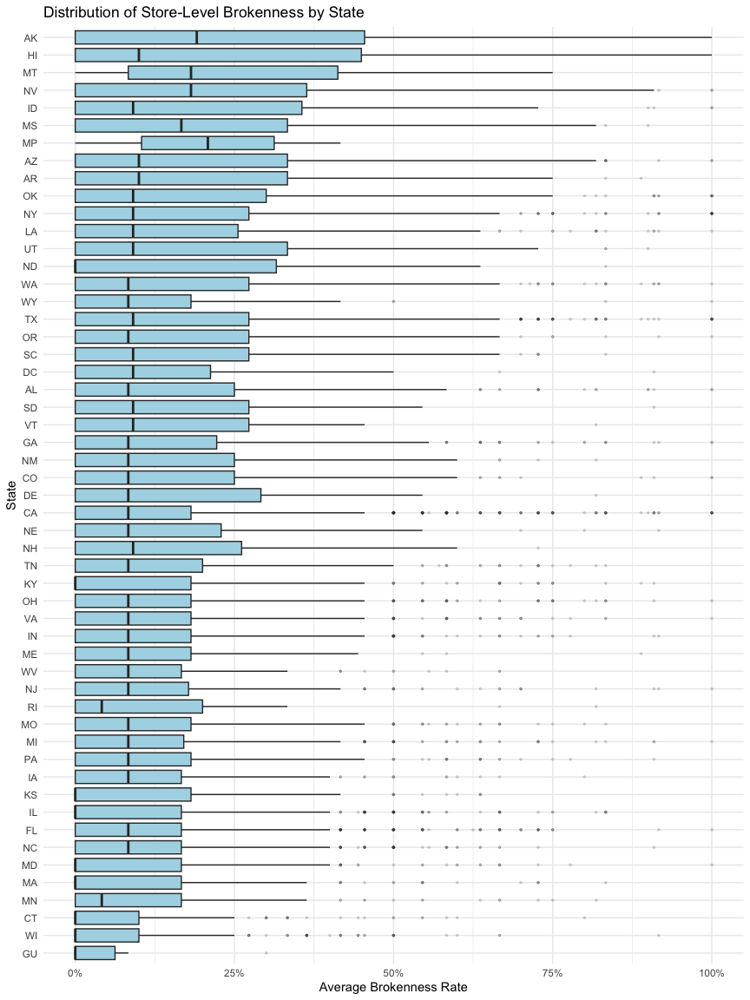
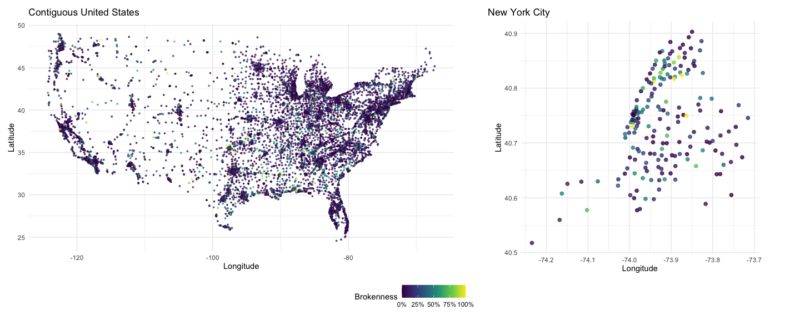

p8105_mtp_yr2560
================
Yiman Rui
2026-10-26

## Introduction

This project examines McDonald’s ice cream machine reliability across
the United States using monthly data from November 2025 to October 2026.
The analysis focuses on data quality, machine brokenness, temporal
changes, and geographic differences in machine performance.

## Problem 1 - Data Import

``` r
snapshot_files =
  list.files(
    path = "data",
    pattern = "^mcbroken_.*\\.csv$",
    full.names = TRUE
  )

mcbroken_df =
  read_csv(
    snapshot_files,
    na = c("", "NA"),
    show_col_types = FALSE
  )

store_info_df =
  read_csv(
    "data/store_info.csv",
    show_col_types = FALSE
  )

state_regions_df =
  read_csv(
    "data/state_regions.csv",
    show_col_types = FALSE
  )
```

``` r
mcbroken_df =
  mcbroken_df |>
  mutate(
    month = as.Date(str_sub(month, 1, 10))
  ) |>
  left_join(store_info_df, by = "store_id") |>
  left_join(state_regions_df, by = "state") |>
  relocate(
    month, store_id, state, region,
    city, street, longitude, latitude
  )
```

``` r
data_summary_df =
  mcbroken_df |>
  summarize(
    n_observations = n(),
    n_months = n_distinct(month),
    n_stores = n_distinct(store_id),
    missing_status = sum(
      is.na(active) & is.na(broken)
    )
  )

data_summary_df |>
  knitr::kable()
```

| n_observations | n_months | n_stores | missing_status |
|---------------:|---------:|---------:|---------------:|
|         163203 |       12 |    13792 |          12024 |

The 12 monthly datasets were combined, and the month variable was
converted to a Date. Store information and geographic regions were added
using `left_join()`. Missing machine statuses were retained for later
investigation.

The resulting dataset contains 163203 observations from 12 months and
13792 unique stores. Important variables include store ID, month, active
status, broken status, state, region, and geographic coordinates.

Store counts by state

``` r
store_counts_df = 
  mcbroken_df |> 
  group_by(state) |> 
  summarize(
    n_stores = n_distinct(store_id),
    .groups = "drop"
  ) |> 
  arrange(desc(n_stores))

store_counts_df |>
  summarize(total_stores = sum(n_stores)) |>
  knitr::kable()
```

| total_stores |
|-------------:|
|        13792 |

``` r
store_counts_df |> 
  filter(
    n_stores == max(n_stores) | n_stores == min(n_stores)
  ) |> 
  knitr::kable()
```

| state | n_stores |
|:------|---------:|
| TX    |     1269 |
| MP    |        2 |

``` r
brokenness_df = 
  mcbroken_df |> 
  filter(active == T) |> 
  summarize(
    n_active = n(),
    n_broken = sum(broken, na.rm = T),
    broken_rate = mean(broken, na.rm = T)
  )

brokenness_df |> 
  knitr::kable(digits = 4)
```

| n_active | n_broken | broken_rate |
|---------:|---------:|------------:|
|   151113 |    21826 |      0.1444 |

The dataset contains 13,792 stores. Texas has the most (1,269), while
Vermont has the fewest (25) among U.S. states. Including territories,
the Northern Mariana Islands has the fewest (2). Among active machine
observations, the brokenness rate was 14.44% (21,826/151,113).

## Problem 2 - Exploratory Analysis

``` r
store_summary_df = 
  mcbroken_df |>  
  group_by(store_id, state, city, street, latitude, longitude) |>
  summarize(
    n_obs = n(),
    n_known = sum(!is.na(active)),
    n_active = sum(active == T, na.rm = T),
    n_inactive = sum(active == F, na.rm = T),
    n_broken = sum(broken == T, na.rm = T),
    .groups = "drop"
  ) |> 
  mutate(
    inactive_rate = ifelse(
      n_known > 0, n_inactive / n_known, NA_real_
    ),
    broken_rate = ifelse(
      n_active > 0, n_broken / n_active, NA_real_
    )
  )
```

Store with few observations

``` r
store_summary_df |> 
  filter(n_obs < 9) |> 
  summarize(
    n_stores = n(),
    one_observation = sum(n_obs == 1)
  ) |> 
  knitr::kable()
```

| n_stores | one_observation |
|---------:|----------------:|
|      239 |              40 |

``` r
store_summary_df |>
  filter(n_obs < 9) |>
  arrange(n_obs, store_id) |>
  slice_head(n = 10) |>
  select(store_id, state, city, n_obs) |>
  knitr::kable()
```

| store_id | state | city          | n_obs |
|---------:|:------|:--------------|------:|
| 10134957 | TX    | Baytown       |     1 |
| 12360802 | TX    | Odessa        |     1 |
| 13932343 | TX    | Conroe        |     1 |
| 14156149 | TN    | Arlington     |     1 |
| 19325268 | TX    | San Marcos    |     1 |
| 21151057 | FL    | Bradenton     |     1 |
| 21352467 | GA    | Dawsonville   |     1 |
| 23675635 | TX    | League City   |     1 |
| 23961571 | AR    | Prairie Grove |     1 |
| 25650118 | MN    | Apple Valley  |     1 |

``` r
# High inactivity
store_summary_df |>
  filter(n_obs >= 9, n_known > 0) |>
  arrange(desc(inactive_rate)) |>
  select(store_id, state, city, street,
         n_obs, n_inactive, n_known, inactive_rate) |>
  slice_head(n = 6) |>
  knitr::kable(digits = 3)
```

| store_id | state | city | street | n_obs | n_inactive | n_known | inactive_rate |
|---:|:---|:---|:---|---:|---:|---:|---:|
| 10435749 | CT | Windsor Locks | MOWGLY LAB | 12 | 9 | 10 | 0.900 |
| 19584360 | AL | Rainsville | 32 Main St W | 12 | 10 | 12 | 0.833 |
| 29488174 | CO | Denver | Denver Airport - DEN CONC B | 12 | 9 | 11 | 0.818 |
| 91277728 | FL | Naples | 6065 Pine Ridge Rd | 12 | 7 | 9 | 0.778 |
| 49765416 | GA | Trenton | 5316 Ga Hwy 136 W | 12 | 8 | 11 | 0.727 |
| 96139117 | NY | Corona | 40-12 National St | 12 | 8 | 11 | 0.727 |

``` r
# High brokenness filter
store_summary_df |>
  filter(n_obs >= 9, n_active >= 9) |>
  arrange(desc(broken_rate), desc(n_active)) |>
  select(store_id, state, city, street,
         n_obs, n_active, n_broken, broken_rate) |>
  slice_head(n = 10) |>
  knitr::kable(digits = 3)
```

| store_id | state | city | street | n_obs | n_active | n_broken | broken_rate |
|---:|:---|:---|:---|---:|---:|---:|---:|
| 10649691 | AK | Anchorage | 3006 Mountain View Dr | 12 | 12 | 12 | 1 |
| 11343808 | NY | Commack | 2 Vanderbilt Pkwy | 12 | 12 | 12 | 1 |
| 12287315 | CA | San Diego | 7140 Miramar Road | 12 | 12 | 12 | 1 |
| 14163925 | NY | Binghamton | 167 Main St | 12 | 12 | 12 | 1 |
| 30848827 | CA | North Hollywood | 11055 Burbank Blvd | 12 | 12 | 12 | 1 |
| 34672346 | CO | Loveland | 1620 Fox Trail Dr | 12 | 12 | 12 | 1 |
| 35761787 | CA | Torrance | 931 Sepulveda Blvd | 12 | 12 | 12 | 1 |
| 38257078 | CA | Livermore | 283 N P St | 12 | 12 | 12 | 1 |
| 38694148 | VA | Springfield | 7909 Rolling Rd | 12 | 12 | 12 | 1 |
| 47891611 | GA | Senoia | 2907 Hwy 85 | 12 | 12 | 12 | 1 |

``` r
# Geographic coordinates
coordinate_outliers_df =
  store_summary_df |>
  filter(
    !(state %in% c("AK", "HI", "GU", "MP")),
    !between(latitude, 24, 50) |
      !between(longitude, -125, -66)
  ) |>
  select(store_id, state, city, street,
         latitude, longitude)

coordinate_outliers_df |>
  knitr::kable(digits = 3)
```

| store_id | state | city | street | latitude | longitude |
|---:|:---|:---|:---|---:|---:|
| 10435749 | CT | Windsor Locks | MOWGLY LAB | 39.103 | -63.496 |
| 36880824 | CA | Los Angeles | MOROCCO MOLE LAB PACIFIC OCEAN | 38.465 | -132.543 |
| 86281474 | NJ | Elizabeth | KNIGHT RIDER LAB ATLANTIC OCEAN | 36.834 | -64.221 |

Among 13,792 stores, 239 have fewer than nine observations, including 40
observed only once.Among stores with at least nine observations, the
highest inactivity rate was 90% in Windsor Locks, CT, while several
stores reported 100% brokenness across 12 active observations. A
geographic check identified three implausible mainland coordinates,
suggesting potential data-quality issues.

``` r
# Nearest store
mailman_lat = 40.8421
mailman_lon = -73.9423

nearest_store_df =
  store_summary_df |>
  filter(!is.na(latitude), !is.na(longitude)) |>
  mutate(
    distance_km = 111.2 * sqrt(
      (latitude - mailman_lat)^2 +
      ((longitude - mailman_lon) *
         cos(mailman_lat * pi / 180))^2
    )
  ) |>
  arrange(distance_km) |>
  slice_head(n = 1)

nearest_store_df |>
  select(store_id, state, city, street, distance_km,
         n_obs, n_active, n_broken, broken_rate) |>
  knitr::kable(digits = 3)
```

| store_id | state | city | street | distance_km | n_obs | n_active | n_broken | broken_rate |
|---:|:---|:---|:---|---:|---:|---:|---:|---:|
| 40651456 | NY | New York | 4040 Broadway | 0.285 | 12 | 12 | 1 | 0.083 |

``` r
# Nearest store history
mcbroken_df |>
  filter(store_id == nearest_store_df$store_id[1]) |>
  arrange(month) |>
  mutate(
    status = case_when(
      is.na(active) | is.na(broken) ~ "Unknown",
      active == FALSE ~ "Inactive",
      broken == TRUE ~ "Broken",
      TRUE ~ "Working"
    )
  ) |>
  select(month,store_id, status) |>
  knitr::kable()
```

| month      | store_id | status  |
|:-----------|---------:|:--------|
| 2025-11-01 | 40651456 | Working |
| 2025-12-01 | 40651456 | Working |
| 2026-01-01 | 40651456 | Working |
| 2026-02-01 | 40651456 | Working |
| 2026-03-01 | 40651456 | Working |
| 2026-04-01 | 40651456 | Working |
| 2026-05-01 | 40651456 | Working |
| 2026-06-01 | 40651456 | Working |
| 2026-07-01 | 40651456 | Working |
| 2026-08-01 | 40651456 | Working |
| 2026-09-01 | 40651456 | Broken  |
| 2026-10-01 | 40651456 | Working |

``` r
# Highest brokenness in NYC
nyc_store_df =
  store_summary_df |>
  filter(
    state == "NY",
    between(latitude, 40.49, 40.92),
    between(longitude, -74.26, -73.70),
    !(city %in% c(
      "Yonkers", "Mount Vernon", "New Rochelle",
      "Valley Stream", "Lawrence"
    ))
  )

nyc_top_df =
  nyc_store_df |>
  filter(n_active > 0) |>
  filter(
    broken_rate == max(broken_rate, na.rm = TRUE)
  ) |>
  arrange(desc(n_active))

nyc_top_df |>
  select(store_id, city, street, n_active,
         n_broken, broken_rate) |>
  knitr::kable(digits = 3)
```

| store_id | city     | street             | n_active | n_broken | broken_rate |
|---------:|:---------|:-------------------|---------:|---------:|------------:|
| 11365554 | New York | 444 Lenox Ave      |       11 |       11 |           1 |
| 56486389 | Bronx    | 875 Garrison Ave   |       11 |       11 |           1 |
| 96030924 | New York | 724 Broadway       |       11 |       11 |           1 |
| 63909737 | Bronx    | 1600 Bruckner Blvd |        9 |        9 |           1 |
| 96139117 | Corona   | 40-12 National St  |        3 |        3 |           1 |

The closest store to Mailman is at 4040 Broadway, with a brokenness rate
of 8.33% (1/12), occurring in September 2026. Five NYC stores reported
100% brokenness, although one had only three active observations.

``` r
# Monthly status transitions
transition_df =
  mcbroken_df |>
  arrange(store_id, month) |>
  group_by(store_id) |>
  mutate(
    previous_month = lag(month),
    previous_active = lag(active),
    previous_broken = lag(broken)
  ) |>
  ungroup() |>
  filter(
    month == previous_month + lubridate::period(months = 1),    
    active == TRUE,
    previous_active == TRUE,
    !is.na(broken),
    !is.na(previous_broken)
  ) |>
  mutate(
    previous_status = if_else(
      previous_broken, "Broken", "Working"
    ),
    current_status = if_else(
      broken, "Broken", "Working"
    )
  ) |>
  count(previous_status, current_status) |>
  pivot_wider(
    names_from = current_status,
    values_from = n,
    values_fill = 0
  ) |>
  mutate(
    previous_status = factor(
      previous_status,
      levels = c("Working", "Broken")
    )
  ) |>
  arrange(previous_status) |>
  select(previous_status, Working, Broken)

transition_df |>
  knitr::kable()
```

| previous_status | Working | Broken |
|:----------------|--------:|-------:|
| Working         |  101446 |   8176 |
| Broken          |    7918 |  10521 |

Among previously working machines, 101,446 remained working and 8,176
became broken. Among previously broken machines, 7,918 were repaired,
while 10,521 remained broken. These results suggest that machine
failures often persist across monthly snapshots.

``` r
# Regional brokenness
region_month_df =
  mcbroken_df |>
  filter(active == TRUE, !is.na(broken)) |>
  group_by(region, month) |>
  summarize(
    broken_rate = 100 * mean(broken),
    .groups = "drop"
  ) |>
  mutate(
    month = format(month, "%b %y")
  ) |>
  pivot_wider(
    names_from = month,
    values_from = broken_rate
  ) |>
  arrange(region)

region_month_df |>
  knitr::kable(
    digits = 1,
    caption = "Monthly brokenness rates (%) by region"
  )
```

| region | Nov 25 | Dec 25 | Jan 26 | Feb 26 | Mar 26 | Apr 26 | May 26 | Jun 26 | Jul 26 | Aug 26 | Sep 26 | Oct 26 |
|:---|---:|---:|---:|---:|---:|---:|---:|---:|---:|---:|---:|---:|
| Alaska | 20.0 | 20.0 | 21.7 | 38.5 | 26.1 | 32.0 | 28.0 | 36.0 | 26.1 | 47.8 | 15.4 | 16.0 |
| Hawaii | 24.2 | 16.4 | 18.8 | 19.4 | 27.3 | 23.4 | 21.3 | 25.0 | 25.0 | 28.6 | 32.8 | 31.8 |
| Northeast | 13.0 | 14.0 | 16.2 | 14.4 | 13.2 | 11.7 | 11.6 | 12.8 | 11.8 | 13.6 | 17.1 | 13.6 |
| Northern Rockies and Plains | 15.5 | 14.6 | 14.7 | 18.3 | 20.7 | 18.8 | 18.4 | 18.8 | 20.3 | 17.8 | 21.5 | 14.6 |
| Northwest | 15.3 | 17.1 | 16.1 | 18.3 | 17.7 | 18.4 | 19.1 | 19.7 | 15.3 | 18.0 | 20.9 | 18.0 |
| Ohio Valley | 12.2 | 13.6 | 12.7 | 12.2 | 13.2 | 12.0 | 12.0 | 13.0 | 13.1 | 12.1 | 14.9 | 13.0 |
| South | 15.8 | 17.3 | 15.8 | 16.5 | 17.5 | 16.7 | 16.7 | 18.8 | 18.1 | 19.0 | 19.3 | 19.0 |
| Southeast | 10.1 | 13.1 | 13.5 | 12.5 | 13.5 | 12.5 | 13.0 | 13.1 | 13.8 | 14.0 | 15.7 | 14.7 |
| Southwest | 14.4 | 18.8 | 19.4 | 16.7 | 16.5 | 15.7 | 17.6 | 19.2 | 19.2 | 17.2 | 20.0 | 18.0 |
| US Territories | 14.3 | 0.0 | 0.0 | 0.0 | 14.3 | 12.5 | 14.3 | 12.5 | 28.6 | 14.3 | 0.0 | 12.5 |
| Upper Midwest | 10.8 | 14.2 | 12.7 | 9.9 | 9.2 | 9.1 | 8.8 | 10.2 | 10.3 | 10.3 | 14.7 | 12.8 |
| West | 13.9 | 14.8 | 14.3 | 14.1 | 14.4 | 14.4 | 14.3 | 15.0 | 16.0 | 14.2 | 18.8 | 16.8 |

Monthly brokenness rates (%) by region

Brokenness rates varied across regions and months, with Alaska reaching
47.8% in August 2026, while the Ohio Valley remained relatively stable
at approximately 12–15%.

## Problem 3

``` r
# Brokenness by state
state_month_df =
  mcbroken_df |>
  filter(active == TRUE, !is.na(broken)) |>
  group_by(state, month) |>
  summarize(
    broken_rate = mean(broken),
    .groups = "drop"
  ) |>
  mutate(
    month_label = factor(
      format(month, "%b %y"),
      levels = format(
        sort(unique(mcbroken_df$month)),
        "%b %y"
      )
    )
  )

state_month_df |>
  ggplot(aes(
    x = month_label,
    y = state,
    fill = broken_rate
  )) +
  geom_tile(color = "white", linewidth = 0.2) +
  scale_fill_viridis_c(
    labels = scales::percent_format(),
    name = "Brokenness"
  ) +
  labs(
    title = "Monthly Brokenness Rate by State",
    x = "Month",
    y = "State"
  ) +
  theme_minimal() +
  theme(
    axis.text.x = element_text(
      angle = 45, hjust = 1
    ),
    axis.text.y = element_text(size = 8),
    panel.grid = element_blank(),
    legend.position = "bottom"
  )
```

<!-- -->
Brokenness rates were generally low across most states and months,
although some states experienced substantial monthly spikes, indicating
temporal variation.

``` r
store_avg_df =
  mcbroken_df |>
  group_by(
    store_id, state, city, street,
    latitude, longitude
  ) |>
  summarize(
    n_active = sum(active == TRUE, na.rm = TRUE),
    avg_broken = mean(
      broken[active == TRUE], na.rm = TRUE
    ),
    .groups = "drop"
  ) |>
  mutate(
    avg_broken = if_else(
      is.nan(avg_broken),
      NA_real_,
      avg_broken
    )
  )

# boxplot
store_avg_df |>
  filter(!is.na(avg_broken)) |>
  mutate(
    state = fct_reorder(
      state, avg_broken, .fun = mean
    )
  ) |>
  ggplot(aes(
    x = state,
    y = avg_broken
  )) +
  geom_boxplot(
    fill = "lightblue",
    outlier.alpha = 0.15,
    outlier.size = 0.6
  ) +
  coord_flip() +
  scale_y_continuous(
    labels = scales::percent_format()
  ) +
  labs(
    title = "Distribution of Store-Level Brokenness by State",
    x = "State",
    y = "Average Brokenness Rate"
  ) +
  theme_minimal()
```



Store-level brokenness rates varied considerably within states. Alaska
and Hawaii showed relatively high average brokenness, while many states
had lower medians but some stores with exceptionally high rates.

``` r
# geographic coordinates
library(patchwork)

continental_df =
  store_avg_df |>
  filter(
    !(state %in% c("AK", "HI", "GU", "MP")),
    between(latitude, 24, 50),
    between(longitude, -125, -66)
  )

nyc_plot_df =
  store_avg_df |>
  semi_join(
    nyc_store_df |> select(store_id),
    by = "store_id"
  )

# two panel plots
us_plot =
  continental_df |>
  ggplot(aes(
    x = longitude,
    y = latitude,
    color = avg_broken
  )) +
  geom_point(size = 0.6, alpha = 0.7) +
  scale_color_viridis_c(
    limits = c(0, 1),
    labels = scales::percent_format(),
    na.value = "grey70",
    name = "Brokenness"
  ) +
  coord_quickmap() +
  labs(
    title = "Contiguous United States",
    x = "Longitude",
    y = "Latitude"
  ) +
  theme_minimal()

nyc_plot =
  nyc_plot_df |>
  ggplot(aes(
    x = longitude,
    y = latitude,
    color = avg_broken
  )) +
  geom_point(size = 2, alpha = 0.8) +
  scale_color_viridis_c(
    limits = c(0, 1),
    labels = scales::percent_format(),
    na.value = "grey70",
    name = "Brokenness"
  ) +
  coord_quickmap() +
  labs(
    title = "New York City",
    x = "Longitude",
    y = "Latitude"
  ) +
  theme_minimal()

(us_plot | nyc_plot) +
  plot_layout(
    widths = c(1.4, 1),
    guides = "collect"
  ) &
  theme(legend.position = "bottom")
```



Stores were more densely concentrated in the eastern United States and
major urban areas. Within NYC, brokenness rates varied across nearby
stores, suggesting no clear uniform geographic pattern.
